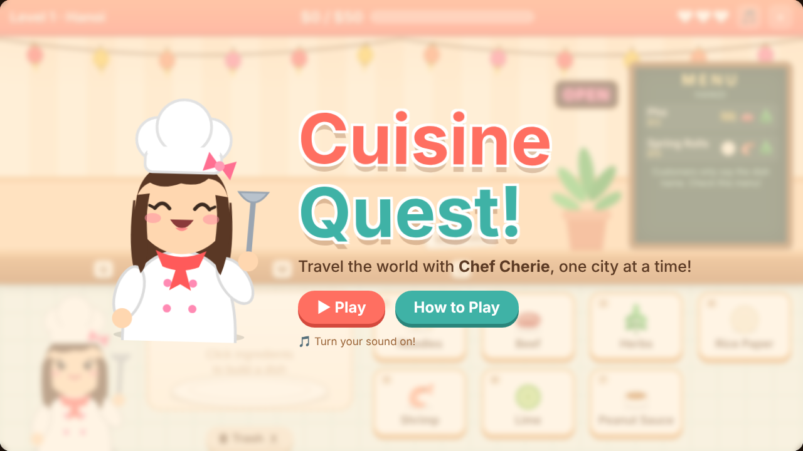
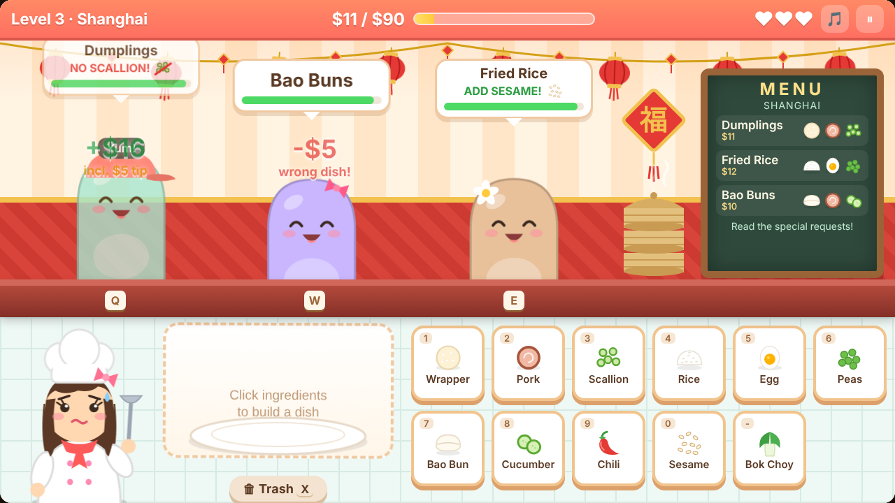

# 🍜 Cuisine Quest 🍔

Travel the world with **Chef Cherie**, one city at a time! Customers tell you the name of the dish they want. Check the menu, build the dish, and serve it before they run out of patience.

This is a **demo** of a bigger game idea. It includes the first 5 cities, and the full game would keep going with more cities (Seoul, Bangkok, Paris, Mexico City, Mumbai, and more).

**Made by:** Amy _(add your full name and any teammates' names here)_

**▶ Play online:** https://YOUR-USERNAME.github.io/cuisine-quest/ _(replace with your GitHub Pages link)_

---

## How to start the game

**Option 1: Play in the browser (easiest)**
Open the link above. Nothing to install.

**Option 2: Run it from the files**
1. Download this repository (green **Code** button → **Download ZIP**) and unzip it.
2. Double-click `index.html`. It opens in your web browser (Chrome, Edge, Safari or Firefox).

No packages, installs or setup needed. The game is plain HTML, CSS and JavaScript.

🔊 **Turn your sound on!** The game has background music and sound effects.

---

## Goal

Earn enough money in each city to unlock the next one. Finish all 5 cities and impress the **food critic** in New York to win the demo.

## Rules

1. **Read the order.** Customers only say the **name** of the dish (for example "Ramen").
2. **Check the menu board.** The menu in the top right shows the ingredients of every dish in that city.
3. **Build the dish.** Click the ingredients to put them on the tray. Any order is fine, but no extras.
4. **Serve it.** Click the customer to hand them the dish.
5. **Special requests:**
   - **"NO ___!"** (red) means leave that ingredient out, for example "Pizza · NO BASIL!"
   - **"ADD ___!"** (green) means add that extra, for example "Fried Rice · ADD CHILI!"
   - Every city has some special requests, and later cities have more. From Shanghai on, some orders have both.
6. **Wrong dish = −$5.** The dish is thrown away and the customer keeps waiting, so you can still make it again.
7. **Be quick.** Each customer has a patience bar that shrinks. Faster service means bigger tips.
8. If **3 customers** leave angry, the level is over.
9. Stars: ⭐⭐⭐ with no angry customers, ⭐⭐ with 1, ⭐ with 2.

## Cities in this demo

| Level | City | Dishes | Goal | Special requests |
|-------|------|--------|------|------------------|
| 1 | 🇻🇳 Hanoi | Pho, Spring Rolls | $50 | Just one: the 3rd customer (add-ons: Lime, Peanut Sauce) |
| 2 | 🇯🇵 Tokyo | Sushi, Ramen | $70 | About 1 in 3 orders (add-ons: Ginger, Corn) |
| 3 | 🇨🇳 Shanghai | Dumplings, Fried Rice, Bao Buns | $90 | About half, some with NO and ADD together (add-ons: Chili, Sesame, Bok Choy) |
| 4 | 🇮🇹 Rome | Pizza, Spaghetti, Gelato | $110 | More than half, some with NO and ADD together (add-ons: Mushrooms, Olives, Pepperoni, Chocolate) |
| 5 | 🇺🇸 New York | Burgers, Hot Dogs, Bagels, Milkshakes | $130 + critic | Most orders, many with NO and ADD together (add-ons: Bacon, Pickles, Onions, Ketchup, Chocolate Syrup) |

Each city has its own restaurant decorations and its own version of the background music. After the goal in New York, the **food critic** arrives and orders two courses with special requests. Serve both correctly to win.

Progress (unlocked cities and stars) is saved in your browser. Use **Reset progress** on the city screen to start over.

## Controls

| Action | Mouse | Keyboard |
|--------|-------|----------|
| Add an ingredient | Click it | The key shown on each button (`1`–`9`, `0`, `-`, `=`, `A`, `S`, `D`, `F`) |
| Serve a customer | Click the customer | `Q` / `W` / `E` (seat 1 / 2 / 3) |
| Throw away the tray | 🗑 Trash button | `X` |
| Pause | ⏸ button | `P` or `Esc` |
| Music on/off | 🎵 button | `M` |

**Tip for presenting:** on the "Choose a City" screen, press `U` to unlock all cities so you can jump to any level.

---

## Files

| File | What it is |
|------|------------|
| `index.html` | The page and all the screens |
| `style.css` | Colors, layout and animations |
| `game.js` | Game logic, cities, recipes, characters and food (drawn with SVG), and music + sound effects (made with the Web Audio API) |
| `screenshots/` | Pictures for this README |

All artwork is drawn in code and all music is generated in code, so the game has no separate image or sound files.

## Built with

HTML, CSS and JavaScript. No libraries. Developed together with an AI agent (Claude).
